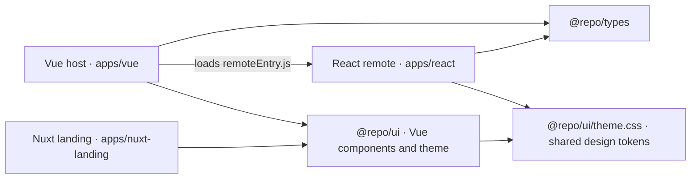

# Vue + React Micro-Frontend Monorepo

This repository is a pnpm/Turborepo workspace containing a Vue dashboard, a React micro-frontend, and a separate Nuxt landing page. The Vue app is the host for the React pages: it loads them at runtime with Module Federation. All apps share selected workspace packages for TypeScript contracts and UI styling.

## Architecture



The Nuxt landing page is a separate app. It shares Vue components and theme assets with the Vue dashboard, but it is not part of the Vue/React Module Federation runtime.

## Applications

| Path | Role | Main details |
| --- | --- | --- |
| `apps/vue` | Dashboard host | Vue 3, Vue Router, Pinia, Nuxt UI, and Vite. Routes include `/`, `/courses`, and `/assignments`. Loads React pages on the courses and assignments routes. Dev server: `http://localhost:5173`. |
| `apps/react` | Remote micro-frontend and standalone preview | React 19, Tailwind CSS 4, and Vite. Exposes `./CoursesPage` and `./AssignmentsPage`. Standalone dev server: `http://localhost:5174`; production preview: `http://localhost:5175`. |
| `apps/nuxt-landing` | Marketing landing page | Nuxt 4 and Nuxt UI. Shares the UI package with the Vue dashboard. Dev server defaults to `http://localhost:3000`. |

## Workspace packages

| Package | Purpose |
| --- | --- |
| `packages/types` (`@repo/types`) | Framework-neutral TypeScript models and props used by the Vue host and React remote. |
| `packages/ui` (`@repo/ui`) | Shared Vue components, shared Tailwind theme tokens, and Nuxt UI theme configuration. |
| `packages/typescript-config` (`@repo/typescript-config`) | Base TypeScript configuration extended by app and package tsconfigs. |

The root `pnpm-workspace.yaml` includes every folder under `apps/*` and `packages/*`. Internal package dependencies use `workspace:*` so local changes are consumed directly by the apps.

## Product and source map

- The Vue dashboard provides the overview page and shell layout, navigation, and learning-queue popover. Its router and views are in `apps/vue/src/router.ts` and `apps/vue/src/views/`; the shell components are under `apps/vue/src/components/layout/`.
- The React courses page provides tabs for all, in-progress, completed, and saved courses. The assignments page provides a course filter and summary. Their components and sample data are under `apps/react/src/components/` and `apps/react/src/data/`.
- The Nuxt app contains the public landing page sections under `apps/nuxt-landing/app/components/learnly/`. `apps/nuxt-landing/app/plugins/shared-ui.ts` registers shared Vue components globally.
- The Vue-to-React mounting adapter is `apps/vue/src/ReactWrapper.vue`; Federation host and remote settings live in each app's `vite.config.ts`.
- Shared contracts live in `packages/types/src/index.ts`. Shared Vue components are exported by `packages/ui/src/index.ts`; its theme and CSS entries are `packages/ui/theme.css` and `packages/ui/vue-styles.css`.

## How Vue and React work together

The React Vite config uses `@originjs/vite-plugin-federation` to expose these modules:

- `react_app/CoursesPage`
- `react_app/AssignmentsPage`

The Vue Vite config registers `react_app` as a remote. `ReactWrapper.vue` asynchronously imports the requested React module, mounts it with `createRoot`, forwards props, and unmounts the React root when its Vue view is removed. `react` and `react-dom` are declared as shared Federation dependencies.

In the current local setup, the Vue host fetches the React remote entry from:

```text
http://localhost:5175/assets/remoteEntry.js
```

The React dev server on port `5174` is useful for running the React app by itself. The integrated Vue host uses the built remote served by the React preview on port `5175`.

## How data is shared

There are two separate kinds of sharing: TypeScript contracts are shared at build time, while the learning queue is shared at runtime through props and callbacks.

### Shared TypeScript contracts

`packages/types/src/index.ts` defines types such as `Course`, `LearningQueueItem`, `CourseFilter`, and `CoursesPageProps`. Both Vue and React import these types, which keeps the host/remote boundary consistent without making either framework depend on the other's state library.

These are TypeScript types, not a runtime data store. They are erased from the built JavaScript and do not synchronize data by themselves.

### Runtime learning-queue flow

The Vue host owns the learning queue in the Pinia store at `apps/vue/src/stores/learningQueue.ts`. On the courses route, `apps/vue/src/views/Courses.vue` passes two props to the React page:

- `queuedCourseIds`: the course IDs currently in the Vue store.
- `onToggleQueue`: a callback that sends a selected course back to the Vue store.

`CoursesPageProps` types this bridge. The React `CoursesPage` renders the host-provided IDs and calls the callback when someone adds or removes a course. Pinia remains the owner of the queue, and the Vue `LearningQueue` component displays the same state.

```text
Vue Pinia store → queuedCourseIds → React CoursesPage
Vue Pinia store ← onToggleQueue(course) ← React CoursesPage
```

When `CoursesPage` runs by itself without host props, it uses a small local React state fallback so the standalone preview remains interactive. The assignments page has its own sample data and local filter state; it does not currently share state with Vue.

Course and assignment data are sample data held in the React app (`apps/react/src/data`). There is no API, database, or persistence layer in this demo, so the Pinia learning queue resets when the page is reloaded.

## How Tailwind and the visual theme are shared

The apps share the design tokens, while each app compiles its own CSS for its own framework:

- `packages/ui/theme.css` is the shared source for the primary palette, semantic `learnly-*` colors, and light/dark CSS variables.
- Vue imports `@repo/ui/vue-styles.css` through `apps/vue/src/style.css`. That shared entry imports Tailwind, Nuxt UI styles, and the shared theme. Its `@source` directive includes the Vue components in `packages/ui` so their Tailwind classes are generated.
- Nuxt loads the same `@repo/ui/vue-styles.css` entry from `apps/nuxt-landing/nuxt.config.ts` and uses the shared Nuxt UI theme configuration from `@repo/ui/theme`.
- React has its own Tailwind entry in `apps/react/src/index.css`. It imports Tailwind with the `rx:` prefix and also imports `@repo/ui/theme.css`, so React can use the same semantic colors with prefixed utilities such as `rx:bg-learnly-brand`.

The `rx:` prefix keeps React's Tailwind utility classes distinct from the unprefixed Vue/Nuxt classes in the host page. React does not consume the shared Vue single-file components: `@repo/ui` components are Vue components for Vue and Nuxt, while React keeps its own React/shadcn components and shares the visual tokens.

## Getting started

### Requirements

- Node.js `20.19+` or `22.12+` (required by Vite 8).
- pnpm `9+`.

### Install dependencies

```bash
pnpm install
```

### Run the integrated Vue + React app

The Federation remote entry is produced by the React production build, so start the React preview first.

**Terminal 1 — build and serve the React remote:**

```bash
pnpm --filter react build
pnpm --filter react preview
```

This serves the remote on `http://localhost:5175`.

**Terminal 2 — start the Vue host:**

```bash
pnpm --filter vue dev
```

Open `http://localhost:5173`. The host can now load the federated React pages.

### Run apps independently

```bash
# React standalone app (does not provide the built remote used by the Vue host)
pnpm --filter react dev

# Nuxt landing page
pnpm --filter nuxt-landing dev
```

`pnpm dev` starts the workspace apps' development servers together, but it does not replace the React build-and-preview step required by the current Vue Federation URL.

## Build commands

```bash
# Build every workspace app/package that defines a build task
pnpm build

# Build one app
pnpm --filter vue build
pnpm --filter react build
pnpm --filter nuxt-landing build

# Generate the Nuxt app as a static site
pnpm --filter nuxt-landing generate

# Format TypeScript, TSX, and Markdown files
pnpm format
```

## Deployment notes

The Vue host and React remote are separate build artifacts. Before deploying them, change the remote URL in `apps/vue/vite.config.ts` from the local `localhost:5175` address to the deployed React `remoteEntry.js` URL. Keep the remote entry and the assets it references deployed together, and configure cross-origin access if the host and remote use different origins.

GitHub Pages can host static builds. For project sites under `https://<user>.github.io/<repository>/`, set the Vite `base` path to `/<repository>/`; a combined Vue/React deployment also needs a path for the React remote and an updated remote URL. The Vue router uses history mode, so a static host needs a route fallback for direct visits or refreshes on paths such as `/courses`; alternatively, the router can use hash history. The Nuxt app has a `generate` script for static output. See the [Vite GitHub Pages guide](https://vite.dev/guide/static-deploy#github-pages) and [GitHub Pages documentation](https://docs.github.com/en/pages).
